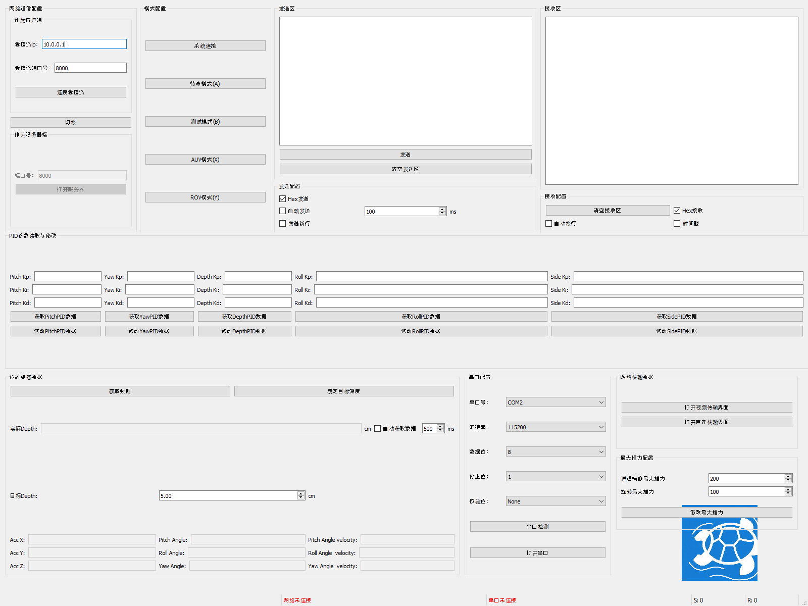

# TTLY 水下机器人上位机

TTLY 是水下机器人控制与数据采集项目，包含 Qt 桌面上位机、Linux 设备端服务、海洋动物声音分类器及独立三维重建工具。上位机支持姿态与深度显示、PID 调参、手柄控制、双目图像采集、音频播放和录制。

| 版本 | 控制通道 | 视频与音频 |
| --- | --- | --- |
| `TTLY4.2tcp` | TCP，经设备端转发到 MCU 串口 | TCP |
| `TTLY4.3serial` | 上位机直接连接 MCU 串口 | TCP |

两版均已在 Linux 完成 Release 构建和离屏窗口冒烟检查；保留的声音模型已完成 CPU 真实推理。运行环境、命令与结果见 [验证记录](docs/VALIDATION.md)。机器人、手柄、相机和麦克风的实机通信尚需在目标设备联调。两版界面的“三维重建”按钮尚无实现，重建通过独立工具完成。

## Windows 可执行程序与界面预览

GitHub Actions 在 Windows 上编译两版 Qt 5 桌面上位机，并使用 `windeployqt` 打包所需的 Qt DLL 和插件。前往 [Windows 构建工作流](https://github.com/Qingyun0118/TTLY/actions/workflows/windows-build.yml)，打开成功的运行记录，在 **Artifacts** 中分别下载 `ttly-tcp-windows` 和 `ttly-serial-windows`。解压整个文件夹后运行其中的 `.exe`；不要只拷贝单独的 EXE。

下方两张图片由 Windows GitHub Actions 在原生 Windows Qt 平台上启动程序，并通过 `QWidget::grab()` 自动捕获。两版在未连接硬件时使用基本一致的主窗口布局，所以初始截图几乎相同；主要区别在控制通信方式。截图已增加文字可见性检查，**不代表**真实串口、网络、手柄、视频或音频设备已连通。

### TCP 控制版


### 串口控制版



工作流支持手动启动，且在 `main` 分支更新时自动构建。Windows 编译和运行验证结果以 GitHub Actions 实际执行状态为准；声音识别所需的 Python 环境及模型需按后文单独配置。

## 目录

```text
TTLY/
├── TTLY4.2tcp/                 # TCP 控制版 Qt 工程
├── TTLY4.3serial/              # 串口控制版 Qt 工程
└── common/runtimepaths.h       # 共用的运行路径配置
PICode/                        # Linux 设备端控制、视频、音频服务
Sound_Rec/                     # 声音识别代码、分类器、依赖和模型卡
examples/audio/smoke.wav        # 合成音频，仅用于跑通推理链路
SLAM3R/                        # 独立三维重建代码
InstantNGP/                    # 数据转换脚本、配置及上游说明
tools/                         # 协议帧生成、串口和音频重命名工具
tests/                         # 无硬件、无真实模型的轻量测试
docs/                          # 协议、清理、第三方及验证说明
```

## 获取代码

```bash
git clone https://github.com/Qingyun0118/TTLY.git
cd TTLY
```

以下 Linux 命令均从仓库根目录开始执行。Qt 控制与音视频窗口可以独立于 Python 声音模型启动；需要声音识别时，再安装声音环境。

## 构建与启动 Qt 上位机

工程使用 **Qt 5.15、C++17、qmake**，依赖 Widgets、Network、SerialPort、Gamepad、Multimedia 和 Concurrent 模块。Ubuntu 的安装命令（Qt 5 开发包位于 `universe` 软件源）：

```bash
sudo apt update
sudo apt install build-essential qtbase5-dev qt5-qmake qtmultimedia5-dev libqt5serialport5-dev libqt5gamepad5-dev
qmake -v
```

确认 `qmake -v` 显示 Qt 5；Qt 6 的音频 API 与此工程不同。分别构建两个版本：

```bash
mkdir -p build/tcp build/serial
(
    cd build/tcp
    qmake ../../TTLY/TTLY4.2tcp/TTLY.pro CONFIG+=release CONFIG-=debug
    make -j2
)
(
    cd build/serial
    qmake ../../TTLY/TTLY4.3serial/TTLY.pro CONFIG+=release CONFIG-=debug
    make -j2
)
```

从仓库根目录启动所需版本：

```bash
./build/tcp/ttly-tcp
# 或
./build/serial/ttly-serial
```

本次实际验证环境为 **Ubuntu 26.04.1 x86_64、Qt 5.15.18、qmake 3.1、G++ 15.2**。两版完整编译、主窗口/音频窗口/视频窗口的离屏创建、默认端口与输出路径检查均通过；编译时项目路径宏的含空格路径 qmake/C++ 小工程检查也通过。离屏检查不代替物理设备通信测试。

原工程的 Windows 配置为 **Qt 5.15.2 / MinGW 64 位**。现在 [Windows GitHub Actions 构建](https://github.com/Qingyun0118/TTLY/actions/workflows/windows-build.yml) 使用 **Qt 5.15.2 / MSVC 2019 64 位**，已完成两版 Release 编译、`windeployqt` 打包及离屏 UI 截图；尚未进行实体机器人或各类外设的 Windows 联调。在 Qt Creator 中打开对应 `TTLY.pro` 并选择匹配的 Qt 5 Kit；使用 MinGW 手工构建时用 `mingw32-make`，分发程序时使用匹配版本的 `windeployqt` 部署 DLL 与插件。

## 跑通声音识别

使用 **Python 3.10**。本次通过 uv 0.13.1 安装 Python 3.10.22，并在 CPU 上完成真实模型推理；完整依赖快照见 [Linux 锁定清单](Sound_Rec/requirements-linux-py310.lock)。

先安装 [uv](https://docs.astral.sh/uv/getting-started/installation/)。下面将环境放在用户目录，源码位于 exFAT 等不支持所需符号链接的文件系统时也可使用：

```bash
uv python install 3.10
uv venv --python 3.10 "$HOME/.local/share/ttly/venv"
export TTLY_PYTHON="$HOME/.local/share/ttly/venv/bin/python"
uv pip sync --python "$TTLY_PYTHON" Sound_Rec/requirements-linux-py310.lock
```

普通 Linux 文件系统也可在项目内创建环境：`uv venv --python 3.10 .venv`，并改用 `export TTLY_PYTHON="$PWD/.venv/bin/python"`。只安装主要固定依赖时，使用 `uv pip install --python "$TTLY_PYTHON" -r Sound_Rec/requirements.txt`。Linux 锁定清单用于复现本次 Linux/Python 3.10 环境，其他平台使用基础依赖清单。

准备独立的 YAMNet 特征模型：

```bash
curl -fL 'https://tfhub.dev/google/yamnet/1?tf-hub-format=compressed' -o /tmp/ttly-yamnet.tar.gz
mkdir -p Sound_Rec/.cache/yamnet
tar -xzf /tmp/ttly-yamnet.tar.gz -C Sound_Rec/.cache/yamnet
export TTLY_ROOT="$PWD"
export YAMNET_MODEL="$TTLY_ROOT/Sound_Rec/.cache/yamnet"
CUDA_VISIBLE_DEVICES=-1 TF_NUM_INTRAOP_THREADS=2 TF_NUM_INTEROP_THREADS=1 OMP_NUM_THREADS=2 \
"$TTLY_PYTHON" Sound_Rec/soundimprove.py --yamnet "$YAMNET_MODEL" --audio examples/audio/smoke.wav
```

`smoke.wav` 是合成信号，用于检查依赖、YAMNet、分类器和输出链路是否可运行；它不是动物录音，其预测类别不用于准确率判断。识别自己的录音时，将 `--audio` 后的路径换为 WAV 文件；可重复传入 `--audio` 进行批处理。

仓库保留的 `animal_classifier_pro.joblib3` 与下载的 YAMNet 是两份不同的模型。日常识别直接加载分类器，不需要训练集。当前依赖固定了模型内嵌的 **scikit-learn 1.6.0、XGBoost 2.1.4**，并固定 **setuptools 80.9.0**，以满足 TensorFlow Hub 0.16.1 对 `pkg_resources` 的实际依赖。环境、镜像选项、离线运行和重新训练见 [声音模块说明](Sound_Rec/README.md)，模型信息见 [模型卡](Sound_Rec/MODEL_CARD.md)。

## 配置 Qt 的运行路径

在已设置声音环境的同一终端启动 Qt，识别进程会继承环境变量：

```bash
export TTLY_ROOT="$PWD"
export TTLY_PYTHON="$HOME/.local/share/ttly/venv/bin/python"
export YAMNET_MODEL="$TTLY_ROOT/Sound_Rec/.cache/yamnet"
./build/tcp/ttly-tcp
```

| 配置 | 作用 |
| --- | --- |
| `TTLY_ROOT` | 项目根目录，应包含 `Sound_Rec/soundimprove.py`；显式设置优先 |
| `TTLY_PYTHON` | 声音识别使用的 Python 解释器绝对路径 |
| `YAMNET_MODEL` | YAMNet 本地 SavedModel 目录或模型 URL；CLI 的 `--yamnet` 优先 |
| `TFHUB_CACHE_DIR` | TF Hub 下载缓存；CLI 的 `--cache-dir` 优先 |

未设置 `TTLY_ROOT` 时，程序从 EXE 所在目录和当前目录向上查找项目，最后使用编译时记录的源码根目录。未设置 `TTLY_PYTHON` 时，程序依次查找项目 `.venv` 和 `PATH` 内的 Python。使用用户目录环境时，需要显式设置 `TTLY_PYTHON`，以免找到其他版本的解释器。

照片、图像序列、三维输出位置和录音默认分别位于 `Result/image/`、`Result/images/`、`Result/3d/`、`Result/voice/`，目录按需创建，可在界面修改。`Result/`、环境、模型下载缓存和构建产物不提交到 Git。

## 连接机器人端

机器人端脚本运行于连接 MCU、双目相机和麦克风的 Linux 设备，安装与启动说明见 [PICode/README.md](PICode/README.md)。在设备的独立 Python 环境安装 `PICode/requirements.txt`，再分别用三个终端启动下表服务：

| 功能 | 默认端口 | 启动命令与数据格式 |
| --- | --- | --- |
| 控制 | TCP 8000 | `python PICode/Control.py`；TCP 与 MCU 串口双向透传 |
| 双目视频 | TCP 8001 | `python PICode/VideoTrans.py`；4 字节大端长度 + JPEG 帧 |
| 音频 | TCP 8002 | `python PICode/VoiceTrans.py`；44.1 kHz、16 bit、单声道 PCM |

Qt 默认设备地址为 `10.0.0.1`，应在界面修改为实际设备地址。设备端默认串口 `/dev/ttyS2`、115200 波特率，摄像头索引 `0`、音频输入索引 `2`；根据实际接线、设备能力和访问权限修改。PyAudio 需要 PortAudio，OpenCV 摄像头采集使用 V4L2。串口控制版直接连接 MCU 时无需启动控制转发服务，视频和音频仍使用对应 TCP 服务。

MCU 控制协议使用 `0xAA` 帧头、功能码、数据、16 位累加校验和和 `0xDD` 帧尾。姿态、深度、PID 和控制字段见 [水下机器人上位机需求书](TTLY/水下机器人上位机需求书.md)；辅助帧生成器与串口测试入口见 [tools/README.md](tools/README.md)。

## 独立三维重建

- [SLAM3R](SLAM3R/LOCAL_SETUP.md)：使用独立 Python 环境与 PyTorch/CUDA，提供 GUI 和图像序列重建命令；权重按上游说明取得。
- [InstantNGP 辅助脚本](InstantNGP/LOCAL_SETUP.md)：自行安装 Instant-NGP、COLMAP、FFmpeg，通过 `PATH` 或 `--colmap_binary`、`--ffmpeg_binary` 指定程序。当前目录不含 Instant-NGP 可执行程序。

这些工具未接通当前两版 Qt 的三维重建按钮，也不属于本次真实声音推理或 Qt 冒烟检查覆盖的范围。

## 验证与复现

只依赖 Python 标准库的轻量测试：

```bash
python3 -m unittest discover -s tests -v
```

测试覆盖声音 CLI 参数、路径与错误退出码，以及 WAV 切割和拼接。真实验证另包括两版 Qt Release 构建、离屏窗口检查、带空格源码路径构建和保留分类器的 CPU 推理。两条短录音分别得到 `Harp Seal (0.61)`、`Humpback Whale (0.99)`；另有两条约 26 秒长录音和公开合成样例完成推理，批处理均成功退出。这些是运行样例，不是数据集准确率评估。详细环境与更多执行结果见 [docs/VALIDATION.md](docs/VALIDATION.md)。

## 许可与第三方内容

项目自有代码、文档、测试和作者训练并授权公开的分类模型采用 [Apache-2.0](LICENSE)，范围说明见 [NOTICE](NOTICE)。`SLAM3R/` 中的第三方代码保留原有 CC BY-NC-SA 4.0 等文件标注；`InstantNGP/` 保留 NVIDIA Source Code License-NC，FLIP 文件另有自身条款。项目的 Apache-2.0 不替换这些独立许可，详见 [第三方说明](docs/THIRD_PARTY.md)。

训练音频、历史比赛结果、旧版本、第三方 Windows 程序及原本机环境不随公开源码分发。历史整理范围见 [清理记录](docs/CLEANUP.md)；模型的来源、哈希和使用流程见 [模型卡](Sound_Rec/MODEL_CARD.md)。
